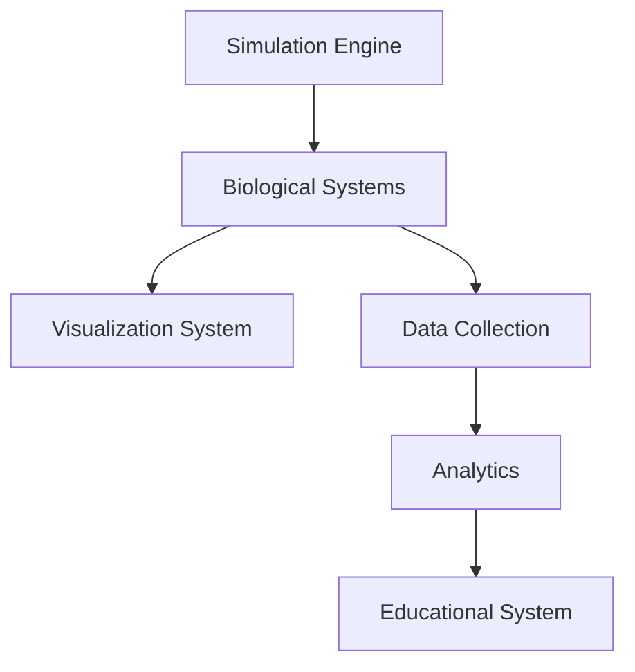
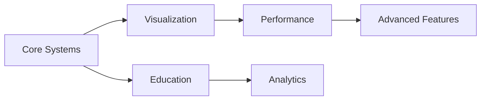

# Neurotransmitter Simulation - Architecture Documentation

## System Architecture Overview

### 1. Core Components

#### 1.1 Simulation Engine
```
src/
├── core/
│   ├── Simulation.js        # Main simulation controller
│   ├── TimeManager.js       # Handles simulation timing and updates
│   └── EventSystem.js       # Manages simulation events and callbacks
```

#### 1.2 Biological Systems
```
src/
├── biological/
│   ├── SynapticSystem/      # Synaptic transmission components
│   │   ├── SynapticCleft.js
│   │   ├── CalciumChannel.js
│   │   └── VesicleSystem.js
│   ├── Neurotransmitters/   # Neurotransmitter implementations
│   │   ├── BaseNT.js
│   │   ├── Dopamine.js
│   │   ├── Serotonin.js
│   │   └── ...
│   └── Receptors/          # Receptor system components
│       ├── ReceptorBase.js
│       ├── ReceptorTypes.js
│       └── SecondMessenger.js
```

#### 1.3 Visualization System
```
src/
├── visualization/
│   ├── SceneManager.js     # Three.js scene management
│   ├── CameraController.js # Camera and view controls
│   ├── Renderer.js         # Custom rendering pipeline
│   └── Effects/           # Visual effects system
│       ├── ParticleSystem.js
│       ├── ShaderEffects.js
│       └── PostProcessing.js
```

### 2. Educational Components

#### 2.1 Learning System
```
src/
├── education/
│   ├── TutorialSystem/    # Interactive tutorials
│   │   ├── TutorialManager.js
│   │   ├── StepManager.js
│   │   └── ProgressTracker.js
│   ├── QuizSystem/        # Assessment system
│   │   ├── QuizManager.js
│   │   ├── QuestionBank.js
│   │   └── ScoreTracker.js
│   └── Documentation/     # Educational content
│       ├── ContentManager.js
│       └── HelpSystem.js
```

#### 2.2 Data Visualization
```
src/
├── analytics/
│   ├── DataCollector.js   # Data gathering system
│   ├── Visualization/     # Data visualization components
│   │   ├── GraphManager.js
│   │   ├── HeatmapSystem.js
│   │   └── TimeSeries.js
│   └── Analysis/         # Data analysis tools
│       ├── Metrics.js
│       └── Statistics.js
```

### 3. Performance Systems

#### 3.1 Optimization
```
src/
├── optimization/
│   ├── ObjectPool.js      # Object pooling system
│   ├── LODSystem.js       # Level of detail management
│   ├── MemoryManager.js   # Memory optimization
│   └── PerformanceMonitor.js
```

#### 3.2 Resource Management
```
src/
├── resources/
│   ├── AssetLoader.js     # Resource loading system
│   ├── CacheManager.js    # Resource caching
│   └── TextureManager.js  # Texture management
```

### 4. Advanced Features

#### 4.1 Drug System
```
src/
├── pharmacology/
│   ├── DrugSystem/        # Drug interaction system
│   │   ├── DrugManager.js
│   │   ├── InteractionMatrix.js
│   │   └── EffectTracker.js
│   └── Pathology/         # Disease state simulation
│       ├── ConditionManager.js
│       └── TreatmentSystem.js
```

#### 4.2 Research Tools
```
src/
├── research/
│   ├── Measurement/       # Measurement tools
│   │   ├── ProbeSystem.js
│   │   └── DataLogger.js
│   └── Analysis/         # Research analysis tools
│       ├── ExperimentManager.js
│       └── ResultsAnalyzer.js
```

## Component Relationships

### Data Flow


### System Dependencies


## Technical Stack

### Frontend
- Three.js for 3D rendering
- WebGL 2.0 for advanced graphics
- Modern JavaScript (ES6+)
- HTML5/CSS3 for UI

### Development Tools
- Node.js for development
- Webpack for bundling
- Jest for testing
- ESLint for code quality

### Performance Optimization
- Object pooling
- Level of detail system
- Memory management
- Asset optimization

## Security Considerations

### Data Protection
- Secure storage of user progress
- Protected API endpoints
- Data encryption
- Access control

### Performance Security
- Resource usage limits
- Memory leak prevention
- Error boundary implementation
- Graceful degradation

## Scalability

### Horizontal Scaling
- Modular component design
- Lazy loading
- Resource optimization
- Performance monitoring

### Vertical Scaling
- Memory management
- CPU optimization
- GPU utilization
- Network efficiency

## Maintenance

### Code Organization
- Modular architecture
- Clear separation of concerns
- Consistent coding standards
- Comprehensive documentation

### Update Strategy
- Version control
- Feature flags
- A/B testing
- Rollback procedures

## Testing Strategy

### Unit Testing
- Component testing
- Integration testing
- Performance testing
- Cross-browser testing

### Quality Assurance
- Code review process
- Automated testing
- Performance monitoring
- User feedback system
